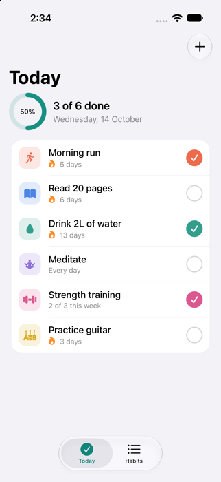
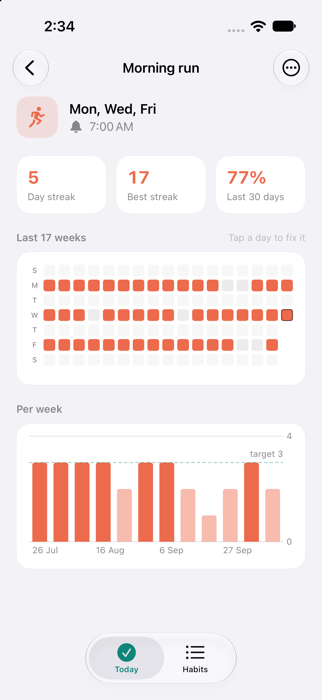
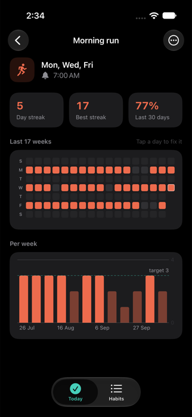
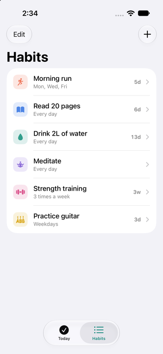
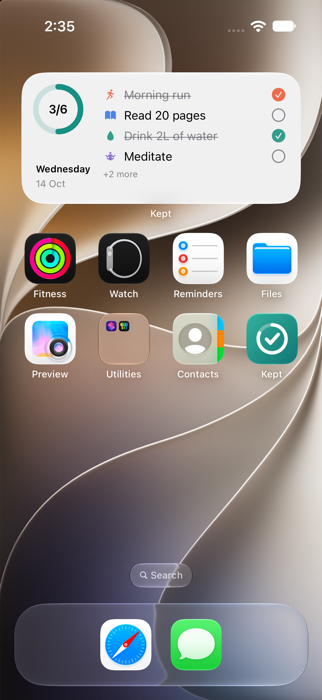

# Kept

A habit tracker for iPhone, written in SwiftUI and SwiftData. It has a Home Screen widget you can tick habits off
from, Siri and Shortcuts support, and streaks that handle schedules properly.

<table>
  <tr>
    <td></td>
    <td></td>
    <td></td>
    <td></td>
    <td></td>
  </tr>
</table>

## Features

- **Today**: only what is due today, a progress ring, one tap to check off, haptic feedback. A "3 times a week" habit
  steps aside once the week's target is met.
- **Schedules**: every day, fixed weekdays (Mon / Wed / Fri), or flexible "N times a week".
- **Streaks that mean something**: days the schedule doesn't ask for never break a streak, today stays open until
  midnight, and flexible habits count weeks instead of days.
- **Habit detail**: current and best streak, 30-day completion rate, a 17-week calendar (tap a day to fix a missed
  tick) and a weekly bar chart against the target (Swift Charts).
- **Widget** (small, medium, Lock Screen circular and rectangular): the medium widget has working check buttons, so
  you can tick a habit without opening the app (App Intents, iOS 17 interactive widgets).
- **Siri and Shortcuts**: "Complete a habit in Kept" with a habit picker.
- **Reminders**: a local notification per habit at a time you choose, on the habit's weekdays.
- Dark mode, Dynamic Type, VoiceOver labels on the checks, calendar and chart.

## Build and run

Needs a Mac with Xcode. It was developed with Xcode 27 (Swift language mode 5); the deployment target is iOS 17.

```bash
brew install xcodegen
git clone <this repo>
cd Kept
xcodegen generate
open Kept.xcodeproj
```

Pick an iPhone simulator and press Run. To try it with sample habits and history, add `-seedDemo` to the scheme's
launch arguments (it only seeds an empty store).

**On a real iPhone:** set your own Team under Signing & Capabilities, and change the bundle IDs and the App Group
(`group.com.harishv27.kept`) in `project.yml` and both `.entitlements` files to ones you own. The widget and the app
must share the same App Group.

## Tests

The date arithmetic, schedules, streaks and stats are in a Swift package with no UI and no SwiftData, so they run on
the Mac in a second:

```bash
cd Packages/KeptCore
swift test        # 29 tests
```

They cover the cases that usually go wrong: the day changing in a different time zone, the daylight-saving day, an
open "today", a missed scheduled day vs. an unscheduled day, flexible weeks, habits created mid-week, and an empty
weekday set.

## How the code is organised

```
Kept/                    The app target
  KeptApp.swift          Entry point
  UI/                    Tabs, Today, Habits list, Habit detail (calendar + chart), Editor, shared components
  Support/               Theme, local reminders, the Siri / Shortcuts phrase
  Dev/                   Sample data for `-seedDemo` (Debug builds only)
KeptWidget/              The widget extension
Shared/                  Compiled into both targets: SwiftData model, shared store, palette, App Intents
Packages/KeptCore/       Pure Swift logic and its tests
docs/screenshots/        Images used in this README
project.yml              XcodeGen definition (the .xcodeproj is generated, not committed)
```

Design notes:

- **Days are integers.** A completion is a "day key" (days since 1970-01-01 on the local calendar), not a `Date`.
  "Did I do it today?" never depends on time zones, DST or the time of the tap, and the weekday of a key is plain
  arithmetic.
- **One store, three processes.** The SwiftData store lives in an App Group container. The app, the widget and the
  Shortcuts action all open the same file, and each write ends with `WidgetCenter.reloadAllTimelines()`.
- **History is an array on the habit.** A habit's completions are `[Int]` on one row, not a related table. Years of
  history are a few kilobytes, a toggle is one write, and the widget needs a single fetch.
- **Reminders are rebuilt, not patched.** Every change removes all of Kept's pending notifications and re-adds them
  from the habits, so there is nothing stale to clean up.

## What has and hasn't been tested

- Checked in the iOS 27 Simulator: creating a habit, ticking and un-ticking, relaunching (data persists), the detail
  screen, light and dark mode, adding the widget to the Home Screen, ticking a habit from the widget (the change
  shows up in the app), and the widget refreshing afterwards.
- **Not tested:** a physical iPhone, an iOS 17 or 18 device (only the iOS 27 simulator was used), notification
  delivery, the Siri / Shortcuts action, the Lock Screen widgets, VoiceOver with a real screen reader, and App Store
  or TestFlight packaging.

## License

[MIT](LICENSE)
